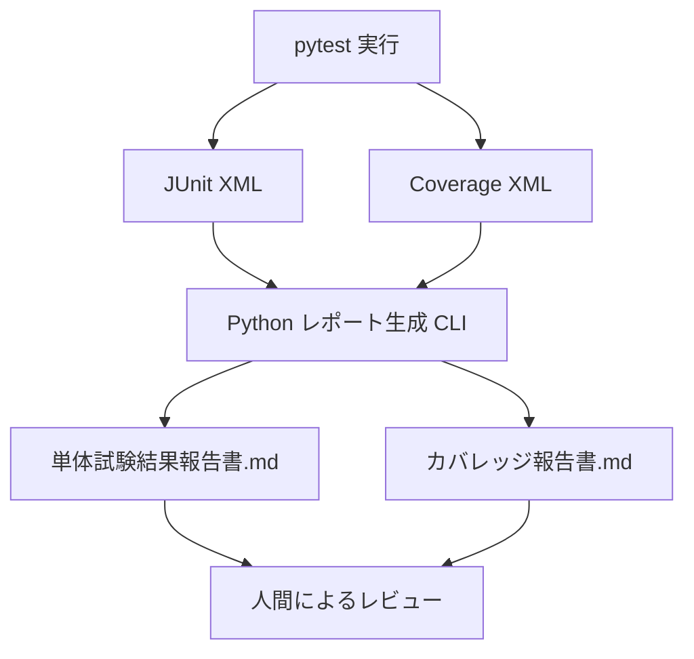

# Python pytest カバレッジツール調査・導入ガイド

- 作成日：2026-10-14
- 対象：Python / pytest / uv を利用する開発プロジェクト
- 目的：単体テストのカバレッジ計測、品質判定、レポート自動生成を標準化する

## 1. 概要

pytest のカバレッジ計測には、**pytest-cov + coverage.py** を推奨する。pytest-cov は pytest と coverage.py を連携させるプラグインであり、行カバレッジ・分岐カバレッジの収集、端末・HTML・XML・JSON 等のレポート出力が可能である。品質ゲートや差分評価には `diff-cover` を組み合わせる。

## 2. 主要ツール比較

| ツール | 主な役割 | 特徴 | 推奨用途 |
|---|---|---|---|
| **pytest-cov** | pytest 実行時のカバレッジ収集 | pytest のオプションから coverage.py を制御 | 標準の単体テスト実行 |
| **coverage.py** | Python コードの計測・分析 | 行・分岐計測、HTML/XML/JSON出力、除外設定 | 計測エンジン・詳細設定 |
| **diff-cover** | 変更行のカバレッジ判定 | coverage XML と Git 差分を比較 | プルリクエスト品質ゲート |
| **pytest-testmon** | 変更に影響するテストの選択 | 変更検知に基づくテスト実行の効率化 | 大規模プロジェクトの実行時間短縮 |
| **Codecov** | カバレッジの集約・可視化 | CI の結果、履歴、PR差分を管理する外部サービス | チームでの継続監視 |

> pytest-testmon はカバレッジ報告書の代替ではなく、テスト選択を効率化する補助ツールである。Codecov はローカル計測ツールではなく外部サービスである。

## 3. カバレッジ指標と限界

| 指標 | 意味 | pytest-cov / coverage.py |
|---|---|---|
| 行・ステートメントカバレッジ（C0相当） | 実行された行・文の割合 | 対応 |
| 分岐カバレッジ（C1相当） | 分岐からの遷移経路が実行された割合 | 対応（`--cov-branch`） |
| 条件カバレッジ（C2） | 複合条件の個々の真偽値の網羅 | 標準では直接計測しない |
| MC/DC | 各条件が判定結果に独立して影響することを確認 | 標準では直接計測しない |
| 関数カバレッジ | 関数単位での実行有無 | 標準の主要指標ではない。別途集計が必要 |

**注意**：Python の行カバレッジはソース行単位であり、厳密な文網羅（C0）と常に一致するわけではない。また coverage.py の分岐は制御フロー上の遷移を測るもので、すべての論理条件の真偽組合せを検証するものではない。

## 4. uv を利用した導入

```bash
uv add --dev pytest pytest-cov
```

任意で差分カバレッジツールを追加する。

```bash
uv add --dev diff-cover
```

## 5. 基本的な実行方法

```bash
uv run pytest \
  --cov=src \
  --cov-branch \
  --cov-report=term-missing \
  --cov-report=html:reports/htmlcov \
  --cov-report=xml:reports/coverage.xml \
  --junitxml=reports/junit.xml
```

| オプション | 説明 |
|---|---|
| `--cov=src` | `src` ディレクトリを計測対象とする |
| `--cov-branch` | 分岐カバレッジも計測する |
| `--cov-report=term-missing` | 未実行行をターミナルに表示する |
| `--cov-report=html:...` | 人間が確認しやすいHTMLレポートを生成する |
| `--cov-report=xml:...` | CIや外部ツール向けCoverage XMLを生成する |
| `--junitxml=...` | テスト結果をJUnit XML形式で出力する |

> Windows PowerShellでは複数行の継続記号が異なるため、コマンドを1行にするか、PowerShellのバッククォートを使う。

### 出力例

```text
reports/
├── junit.xml
├── coverage.xml
└── htmlcov/
    └── index.html
```

ターミナル表示例（数値は架空）：

```text
Name                 Stmts   Miss Branch BrPart  Cover
-----------------------------------------------------
src/main.py             80      4     20      2    94%
src/services.py        120     12     30      4    89%
-----------------------------------------------------
TOTAL                  200     16     50      6    91%
```

## 6. pyproject.toml 設定例

以下は **src ディレクトリを計測対象にする** プロジェクトの例である。`src` レイアウトで実際のパッケージ名を対象にする場合は、対象に応じて `source` と `--cov` を調整する。

```toml
[tool.pytest.ini_options]
testpaths = ["tests"]
addopts = [
    "--cov=src",
    "--cov-branch",
    "--cov-report=term-missing",
    "--cov-report=html:reports/htmlcov",
    "--cov-report=xml:reports/coverage.xml",
    "--junitxml=reports/junit.xml",
]

[tool.coverage.run]
branch = true
source = ["src"]

[tool.coverage.report]
show_missing = true
skip_covered = false
fail_under = 80

[tool.coverage.html]
directory = "reports/htmlcov"

[tool.coverage.xml]
output = "reports/coverage.xml"
```

実行コマンド：

```bash
uv run pytest
```

`fail_under = 80` により、coverage.py の総合カバレッジ値が80%未満の場合に失敗扱いとなる。分岐計測を有効にすると、総合値には行・分岐の両方が反映される。**行80%かつ分岐80%を別々に保証する設定ではない**。

## 7. 差分カバレッジの評価

`diff-cover` は Git の比較対象ブランチとの差分行を対象にカバレッジを評価できる。

```bash
uv run diff-cover reports/coverage.xml --compare-branch=origin/main --fail-under=90
```

このコマンドは変更行のカバレッジ90%以上を品質ゲートとする例である。実行前に比較対象ブランチを取得しておくこと。差分が存在しない場合の扱いや、削除行・非実行行の評価についてはツールの仕様を確認する。

## 8. 初期品質基準（提案例）

| 項目 | 初期基準 | 判定方法 |
|---|---|---|
| pytest テスト結果 | 失敗0件 | pytest 終了コード、JUnit XML |
| 総合カバレッジ | 80%以上 | coverage.py の `fail_under` |
| 変更行カバレッジ | 90%以上 | diff-cover |
| 重要な業務ロジック | 主要正常系・異常系・境界値をテスト | テスト仕様書レビュー |
| 未計測箇所 | 理由を確認し、必要に応じてテスト追加 | HTMLレポート |
| レポート | テスト結果・Coverage XMLを保存 | CI成果物 |

数値はあくまで導入時の提案値。カバレッジが高くてもアサーション不足や仕様の見落としは検出できないため、**試験観点一覧・単体試験仕様書のレビュー**と併用する。

## 9. Markdown報告書の自動生成

### 9.1 入出力

| 入力ファイル | 用途 | 主な取得情報 |
|---|---|---|
| `reports/junit.xml` | 単体試験結果の解析 | テスト数、成功・失敗・エラー・スキップ、所要時間 |
| `reports/coverage.xml` | カバレッジ結果の解析 | 行・分岐カバレッジ、ファイル別の実行状況 |

生成するMarkdown文書：

1. `reports/unit_test_report.md` — 実行日時、対象、試験件数、結果内訳、失敗テスト一覧、総合判定。
2. `reports/coverage_report.md` — 総合カバレッジ、ファイル別カバレッジ、未実行箇所、閾値判定、改善対象。

### 9.2 処理フロー



### 9.3 実装時の注意

- JUnit XMLはpytestの設定やバージョンにより属性の位置が異なることがある。`testsuite` / `testsuites` の双方を考慮する。
- テスト成功件数は、総数から失敗・エラー・スキップを差し引いて算出する。収集失敗や実行中断は別途扱う。
- Coverage XMLの `line-rate` と `branch-rate` は一般に0〜1の比率であり、表示時に100倍する。
- 分岐カバレッジの対象が存在しない場合、分母0を考慮し、無理に100%と解釈しない。
- 生成したMarkdownには、コマンド、Gitコミット、Pythonバージョン、計測日時、品質基準を記録すると追跡しやすい。
- XML解析にはPython標準ライブラリの `xml.etree.ElementTree` を利用できる。外部由来の信頼できないXMLを扱う場合は安全なパーサーを検討する。

## 10. CI/CD連携の考え方

推奨パイプライン：

1. `uv sync --dev` で依存関係を準備する。
2. `uv run pytest` でテストとカバレッジを計測する。
3. `diff-cover` で変更行の品質ゲートを評価する。
4. JUnit XML / Coverage XML を解析し、Markdown報告書を生成する。
5. XML・HTML・MarkdownをCI成果物として保存する。
6. 必要に応じてレビュー後、GitHub Wiki等へ報告書を同期する。

**失敗時の注意**：テスト失敗やカバレッジ閾値未達でもレポートを残せるよう、CIの成果物アップロード処理は失敗時にも実行するよう設定する。

## 11. 推奨構成と選定理由

**標準構成：`pytest + pytest-cov + coverage.py + JUnit XML + Markdown生成CLI`**

- 既存のpytestテスト資産をそのまま活用できる。
- ローカル実行とCI実行で同じ設定を使える。
- HTMLは開発者の詳細確認に、XMLは自動集計に適する。
- Markdown報告書はレビュー・保管・GitHub Wiki掲載に利用しやすい。
- PR品質を強化する場合にdiff-coverを追加できる。

## 12. 参考リンク

- pytest: https://docs.pytest.org/
- pytest-cov: https://pytest-cov.readthedocs.io/
- coverage.py: https://coverage.readthedocs.io/
- diff-cover: https://github.com/Bachmann1234/diff_cover
- pytest-testmon: https://testmon.org/
- Codecov: https://docs.codecov.com/
- uv: https://docs.astral.sh/uv/

---

**結論**：初期導入はpytest-covを中心としたシンプルな構成とし、テスト仕様書レビュー、差分カバレッジ、Markdown報告書自動生成を段階的に追加することを推奨する。
